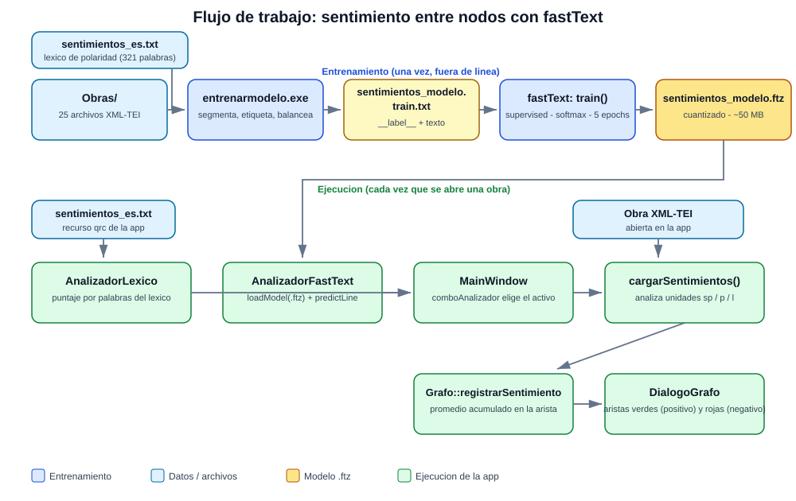

# NLPLiterature
Spanish Clasics  Analisys 

## Tecnology 
C++ 
QT
fastText (Meta)

## Descripcion 
La idea del proyecto es implementar algoritmos de NLP en c++ para analizar obras de literatura en español

## Flujo de trabajo del sentimiento entre nodos

Como se relacionan los archivos, el entrenamiento y el modelo:

1. **Entrenamiento (una vez, fuera de línea).** La herramienta
   `NLPFront/herramientas/entrenarmodelo` lee las obras de `Obras/` y el léxico
   `NLPFront/sentimientos_es.txt`, segmenta parlamentos (`sp`) y párrafos/versos (`p`/`l`), los
   etiqueta con el léxico (etiquetado débil) y escribe `sentimientos_modelo.train.txt`.
2. **El modelo.** fastText entrena un clasificador supervisado de 3 clases (positivo, negativo,
   neutral) sobre ese archivo y guarda `sentimientos_modelo.ftz` (cuantizado, ~50 MB).
3. **En la app.** `NLPFront` carga el `.ftz` al iniciar (si no existe, usa solo el léxico). Al
   abrir una obra, cada unidad donde coinciden personajes se puntúa con el analizador elegido en
   el combo ("Sentimiento: léxico / FastText") y el puntaje se acumula como promedio en la
   arista del grafo, que se dibuja verde (positivo) o rojo (negativo) en el diálogo del grafo.
   El modelo también se puede reentrenar desde la app (botón "Reentrenar modelo"): con el
   proceso completo desde las obras o desde un `train.txt` ajustado a mano.

Los detalles del modelo (arquitectura, datos, hiperparámetros, cuantización, evaluación,
limitaciones y sugerencias de mejora) están en [MODELO_FASTTEXT.md](MODELO_FASTTEXT.md).